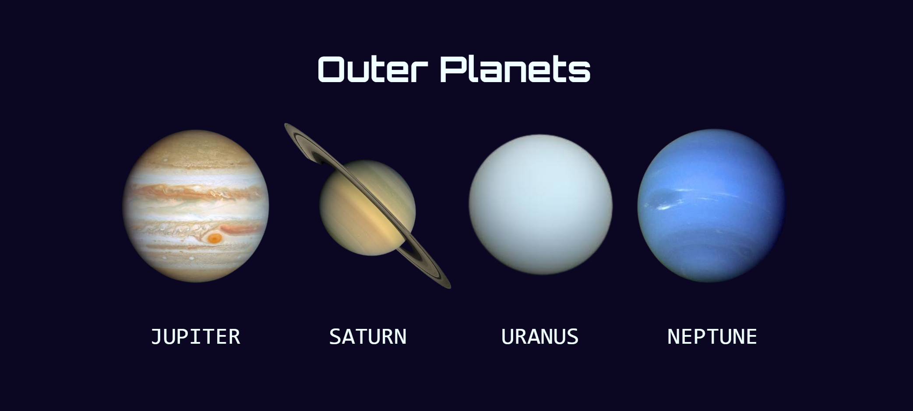

## Solar System Explorer

This is a website about objects in our solar system, intended to educate but also amaze! 

The objects are grouped by the sun, inner, outer, and dwarf planets. To learn more about an object, click on its name or image. This will open a webpage filled with information and fun facts.

Various sources were used in this project, including:
- The offical [NASA website](https://www.nasa.gov/)
- *Human Universe* by Brian Cox
- *The Cosmic Perspective: Stars, Galaxies, and Cosmology* by Jeffery Bennett, Megan Donahue, Nicholas Shneider, and Mark Voit

stay tuned for some possible future updates, like new objects and dwarf planets!!